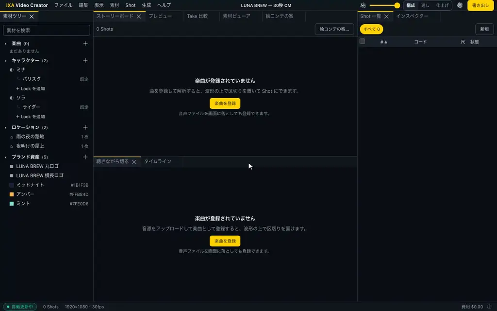
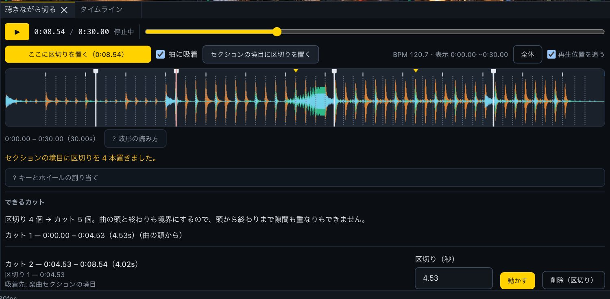
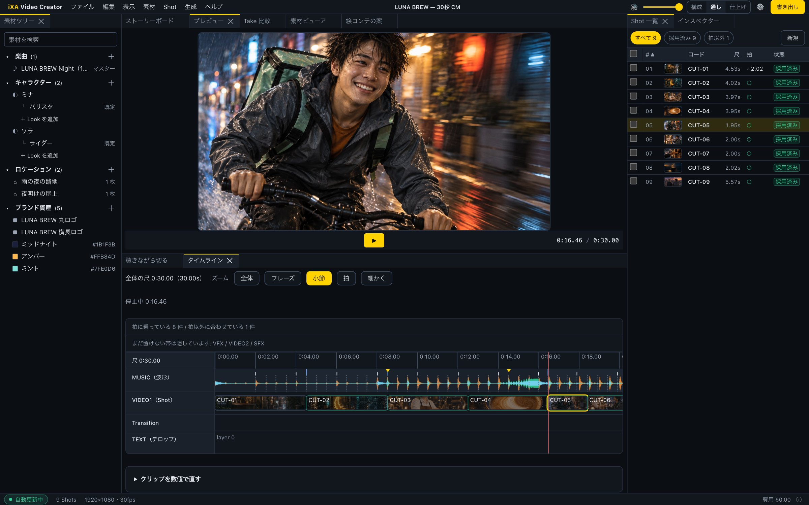
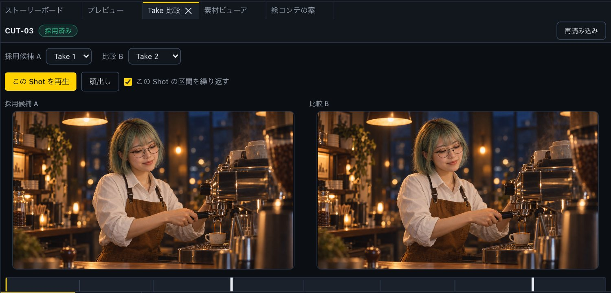
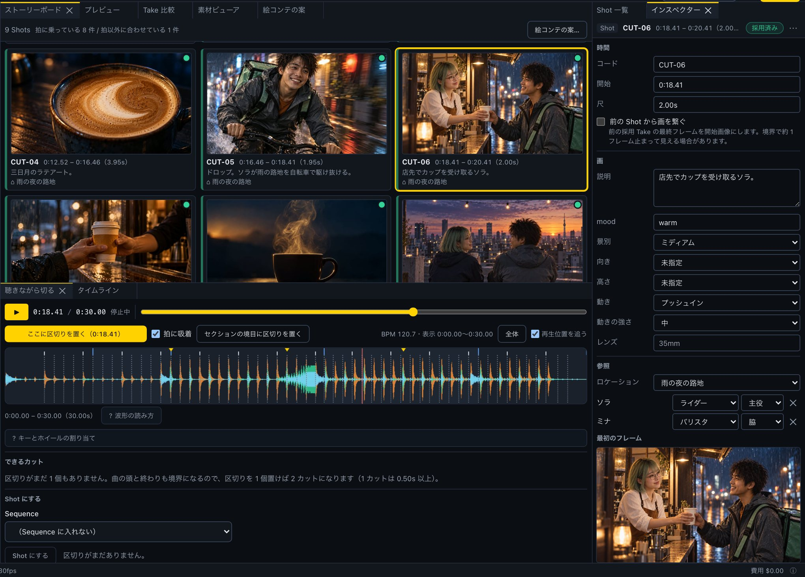
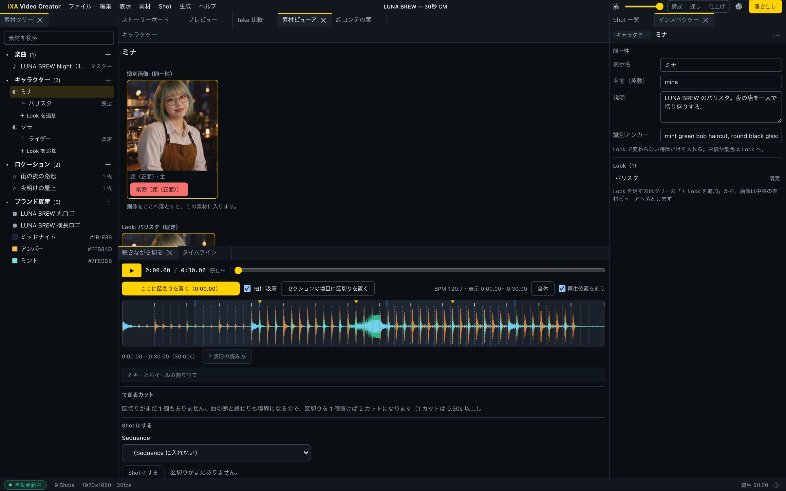

# iXA Video Creator

**曲から作るミュージックビデオの制作台。作業は、AI エージェントに頼むこともできる。**
曲に合わせて切り、絵コンテ・絵・映像・BGM・効果音の下書きを AI に任せ、プレビューで見たままを書き出す。
直しはワークベンチの「AI エージェント」タブにふつうの言葉で頼めるし、Claude Code や Codex から MCP で
制作を丸ごと進めさせることもできる。

> **エージェントに入れてもらう。** この Mac の Claude Code か Codex にこう頼む:
> *「https://github.com/kabatin/ixa-video-creator をこの Mac に入れて、INSTALL.md のとおり使えるところまで整えて」*

[](https://github.com/kabatin/ixa-video-creator/actions/workflows/ci.yml) [](https://github.com/kabatin/ixa-video-creator/releases) [](./LICENSE) [](https://github.com/kabatin/ixa-video-creator/stargazers)

[English README](./README.md) · MIT · TypeScript モノレポ · v0.7

| 🎵 曲から作る | 🤖 頼んで作る |
|---|---|
|  |  |
| 曲を落とす → セクションの境目で切る → Shot → Shot ごとに Take → 通しで再生。 | ふつうの言葉で頼む。読むだけならすぐ動き、生成・削除・書き出しは「実行」を押すまで待つ。 |

---

## 4 行で言うと

- **曲がそのままタイムラインになる。** カットは波形の上の位置なので、Shot の尺は曲が求める長さちょうどになり、その長さがそのまま動画の AI に渡る。
- **AI エージェントと一緒に作れる。** ワークベンチの中のチャットのタブと、Claude Code・Codex 向けの 58 ツールの MCP サーバ。エージェントが作ったものは、ふつうの Shot・Take・クリップとして並び、見て直せて、⌘Z で戻せる。
- **Mac 1 台がスタジオになる。** 絵（FLUX.2 [klein]）、映像（MiniMax H3・Wan 2.2）、曲と BGM（ACE-Step 1.5・Stable Audio 3・MiniMax-Music3）、効果音（Stable Audio 3）を、手元で無料で作れる。有料の API は任意で、明示しない限り開かない。
- **費用と弱点を隠さない。** 数字は実測のものだけ。始める前に[正直な制約](#正直な制約)を読んでほしい。

## このツールで作ったもの


<sub>**戦子のタイムトラベル** — 縦 9:16・26 秒・7 Shot のショート。最初のフレーム・映像・曲・効果音はすべて Mac 1 台の手元のモデルで作り、ナレーションの声だけ Gemini API を使った。</sub>


<sub>**NIGHT RUN** — 横 16:9・66 秒・41 Shot の予告編。ナレーション・エフェクト・効果音の段つき。書き出したファイルからコマを抜いた。</sub>

## AI エージェントに頼む

入り口は 2 つあり、使うツールは同じ。

### ワークベンチの中で:「AI エージェント」タブ


下のドックの **AI エージェント** を開いて、したいことを書く —「この Shot の効果音を派手に」「Shot を要約して」「サビの小節頭ごとにフラッシュを入れて」。
依頼には、作品・選んでいる Shot・再生位置が自動で添えられるので、「この Shot」は思ったとおりの Shot を指す。

- **新しいタスク／作業を継続。** 新しく会話を始めるか、前の会話の続きから話す。会話は**作品ごとに**残るので、翌週の「続き」も何をしたかを覚えている。
- **何をしているかが見える。** 返事は作業しながら流れてくる。ツールの呼び出しは 1 行ずつ（「作品を読んでいる」「動きを分析している」…）、経過時間と ✓ / ✗ つきで出る。
- **確認のカード。** 読むだけとふつうの直しはすぐ動く。**生成・削除・書き出し・設定の変更**は、カードで止まる —「実行」「やめる」「以後このタスクでは確認しない」。チャットで「確認なしでいい」と言っても同じ。確認はいつでも戻せる。
- **モデルは会話ごとに選べる。** 既定は Sonnet。Opus・Haiku も選べる。
- **エージェントの直しも ⌘Z で戻せる。** 自分の操作と同じ API を通るので、取り消しも同じように効く。

**安全の作り**（[ADR-0058](./docs/adr/0058-agent-chat-tab.md)）。タブは Claude Code の CLI を、ixa の MCP のツールだけで起こす — シェルやファイルを触る組み込みのツールは無く、制作者自身の Claude の設定やフックも読まない。ツールを使う前に必ず確認の関所を通り、確認の答えは**画面からだけ**受ける（エージェントが自分の確認に答えることはできない）。**ほかの作品**を触る操作は、「以後確認しない」の後でも必ず確認する。エージェントの鍵は 1 回のやりとりごとに発行し、MCP の設定ファイル（権限 600）にだけ書き（ログや会話には出さない）、やりとりが終わったら取り消す。同じ作品で動く会話は 1 つだけなので、2 つの会話が同じ直しを取り合うことはない。

### Claude Code・Codex から: MCP サーバ

`apps/mcp` は stdio の MCP サーバ（[ADR-0049](./docs/adr/0049-mcp-server.md)）。画面と同じ API を呼ぶ薄い層で、曲からテロップ・ナレーション・歌詞・音の仕上げ・書き出しまで、制作の全体を **58 のツール**で扱う:

| 段 | ツール |
|---|---|
| 作品 | `ixa_status` · `set_ai` · `create_project` · `get_project` · `update_project` · `duplicate_project` · `import_from_project` |
| 曲 | `generate_music` · `upload_music` · `set_master_track` · `music_overview` |
| Shot と登場人物 | `plan_shots` · `edit_shots` · `restructure_shots` · `draft_storyboard` · `create_character` · `edit_character` · `create_location` · `edit_location` · `manage_brand_assets` |
| 最初のフレーム | `draw_start_frames` · `set_start_frame` · `set_end_frame` · `list_start_frame_history` · `use_start_frame` · `retry_image` · `view` |
| Take | `generate_takes` · `import_take` · `list_takes` · `adopt_take` · `review_take` · `hide_takes` · `upscale_takes` · `wait` · `cancel_jobs` · `align_to_music` |
| テロップと声 | `add_telops` · `list_telops` · `edit_clips` · `remove_telops` · `set_narration` · `speak_narration` · `set_lyrics` |
| エフェクトと音 | `add_effects` · `list_effects` · `remove_effects` · `analyze_motion` · `suggest_sfx` · `generate_sfx` · `upload_sfx` · `list_sfx` · `remove_sfx` · `edit_audio` |
| 届ける | `export` · `export_thumbnail` |
| 履歴 | `list_edits` · `undo` |

**`view` はエージェントの目。** 最初のフレームと Take のコマを**画像として**返すので、エージェントは自分で見て、崩れた手や溶けた車を描き直してから次へ進める。`export_thumbnail` も、できた JPEG を画像で返す。

> 「横 16:9 で 60 秒のショートを作って。夜のストリートレースのあと、夜明けに 2 人が寄り添う」

最初の試作（62 秒・16 Shot、曲づくりも含めてこのツールだけで作った）は、手元の GPU 1 台で約 4 時間だった。長い生成で呼び出しを止めておくことはなく、エージェントは頼んでから `wait` で待つ（`wait` は上限の時間で必ず返る）。

Claude Code への登録（鍵はシェルの環境から渡す。ファイルに直に書かない）:

```json
{
  "mcpServers": {
    "ixa": {
      "command": "/path/to/ixa-video-creator/apps/mcp/node_modules/.bin/tsx",
      "args": ["/path/to/ixa-video-creator/apps/mcp/src/main.ts"],
      "env": {
        "IXA_API_URL": "http://127.0.0.1:3001",
        "IXA_WORKSPACE_ID": "${IXA_WORKSPACE_ID}",
        "IXA_API_TOKEN": "${IXA_API_TOKEN}"
      }
    }
  }
}
```

`IXA_API_TOKEN` は「アクセス用の鍵」のページで発行する自動化用の鍵（[ADR-0046](./docs/adr/0046-passphrase-and-access-tokens.md)）で、いつでも取り消せる。Codex の設定などは [apps/mcp/README.md](./apps/mcp/README.md)。

`pnpm ixa mcp --claude`（または `--codex`）が、この clone 用の登録の 1 行を出す（ワークスペースの ID は入れ、鍵は入れない）。`--write` を付けると実際に登録する。

## 曲が先にある

多くの AI 映像ツールは、プロンプトを書くところから始まってクリップが出てきて、音楽は後から下に敷くものになる。このツールは逆向きに作ってある。

**入力は完成した曲。** 音源を画面に落とすと librosa で解析され（拍・小節頭・ドロップ・3 帯域 RMS）、その時点から**曲がそのままタイムラインになる**。

- 映像の尺は曲の尺。はみ出しようがない
- カットはすべて波形上の位置で、聴きながら置く
- Shot の尺は「どこで切ったか」の結果で、その尺がそのまま動画の AI へ渡る
- 歌詞のある曲なら、流しながら各行の歌い出しで打つだけで時刻付きのテロップになる。絵を 1 枚も作らないうちに、黒い画面で確かめられる

つまり作業は**「曲に対して編集を決め、空いた枠を埋める」**であって、「クリップを作ってから曲に合わせようとする」ではない。最初の制作物は 1 分 56 秒・27 カットのミュージックビデオ。

曲がまだ無ければ、**「曲を作る」**で手元の Mac に作らせる。歌なしの BGM は Stable Audio 3（既定）、歌と歌詞を入れるなら ACE-Step 1.5、ほかに MiniMax-Music3。できた曲は楽曲になり、ほかの楽曲と同じように解析される。



## 空の作品から書き出しまで

メニューの下の帯が、作業の最初から最後までを案内し、次にやる段をいつも目立たせる。済んだ段には ✓ が付き、途中の段は進み具合（件数）が出る。


1. **楽曲** — 音源を落とすか、作る。拍・小節頭・セクションを解析する。
2. **作品の方針** — コンセプト・あらすじ・歌詞・ルック（画風・光・質感）、避けたいものと手本画像。全部の生成に自動で足されるので、書くのは 1 回でよい。
3. **歌詞の時刻** — 曲を流し、各行の歌い出しで Enter を押す。
4. **テロップ** — 時刻の付いた行がテロップになる。黒い画面で流すので、絵にお金を掛けずにタイミングを確かめられる。
5. **ナレーション**（任意）— 原稿を AI の声に読ませるか、自分で録って聞き取らせ、行とテロップにする。ノイズ除去は既定で掛かり、録音ごとに外せる。声の間は曲の音量が下がる。
6. **区切って Shot** — 聴きながら区切りを置く（Enter は画面のどこでも効き、拍に吸着する）。セクションの境目や歌い出しに一度で置くこともできる。
7. **絵コンテ** — 全 Shot の説明・雰囲気・**カメラ**を AI が下書きし、1 件ずつ「なぜこの絵か」を添える。採用するまで Shot は変わらない。
8. **絵** — 各 Shot の最初のフレームを、登場人物の参照画像から AI が描き、自分でチェックする（下）。
9. **Take** — 最初のフレームから Shot ごとの映像を作る。順番待ち・経過・目安が出る。
10. **書き出す** — H.264。全体か、選んだ Shot だけ。`~/Movies/ixa-video-creator/<作品名>/` に置かれる。YouTube のサムネイルも。

段を飛ばしてもよいが、飛ばす前に確かめる。

## 音・仕上げ・AI の見直し

### 映像に合わせて鳴る効果音


「＋ 効果音」は、採用中の Take の動きを分析する（[ADR-0054](./docs/adr/0054-motion-analysis-for-sfx.md)）。コマごとの変化の量、急に動いたところ、そして Take から抜いた 12 コマを Claude に見せて「何が起きているか」。出来事ごとに時刻・長さ・英語の指示の行が出るので、直して、要らない行のチェックを外せば、手元の Stable Audio 3 が音を作って効果音の段に置く。瞬間の音は近くの動きの山に寄せ、音の一番大きいところを出来事の時刻に合わせることもできる。試しの Shot では、手で置いた着地 8 回がすべて検出した山の ±0.1 秒以内に入った。Stable Audio は温まった M5 で、10 秒の音を約 0.5 秒で作る（[ADR-0052](./docs/adr/0052-sound-effects-with-local-stable-audio.md)）。

手持ちの音のファイルも効果音の段に置ける（[ADR-0056](./docs/adr/0056-uploaded-sound-effects.md)）。声・楽曲・効果音は、ほかの作品から取り込める（[ADR-0053](./docs/adr/0053-import-voices-music-sfx.md)）。

### 段に分かれたタイムライン


楽曲・映像・トランジション・ナレーション・テロップ・エフェクト・効果音が、この順にそれぞれの段に並ぶ。時間が重なるクリップは行を分けて出し、隠れない。**エフェクト**は 8 つの型（フラッシュ・光漏れ・スピード線・フィルム焼け・グリッチ・タイトルカード・揺れ・寄りのパンチ）から、型と強さで選ぶ。文から絵を作らないので、プレビューと書き出しが同じコマになる（[ADR-0050](./docs/adr/0050-effect-templates.md)）。クリップ・Shot・トランジション・テロップ・スタイル・キャラクター・楽曲など、ほとんどの直しは **⌘Z** で戻せ、変更履歴は専用のタブで見られる。

### 絵は AI が自分で見直し、映像の作り直しは聞いてから

- **最初のフレーム**（[ADR-0055](./docs/adr/0055-image-check-and-retry.md)）: できた絵を Claude が見て、手足の崩れ・溶けた物・意味の無い文字・別人・主役の欠落を探す。手元の画像の AI なら、誰が見てもリテイクの絵は自動で描き直す（既定で 2 回まで）。描いた絵はすべて残り、前の絵に戻せる。テキストの AI が Claude でなければチェックは飛ばし、「チェックしていない」と残す（黙って合格にしない）。
- **Take**（[ADR-0057](./docs/adr/0057-video-retake-by-request.md)）: レビューで不合格なら「作り直し推奨」と出すだけで、勝手に GPU をもう 10 分使わない。夜にまとめて頼むときは「NG なら自動で作り直す」を付ければ、上限までレビューと作り直しを繰り返す。
- **解像度上げ**の待ち・作成中は Shot 一覧とストーリーボードに出るので、夜の作業の進み具合がひと目で分かる。

### サムネイルも

「ファイル > サムネイルを書き出す…」は、映像と同じ Remotion のコンポジションで 1280×720・2MB 未満の JPEG を描く（[ADR-0051](./docs/adr/0051-youtube-thumbnail.md)）。背景は再生位置のコマ・Shot の絵・AI に描かせたキーアートから選び、題名は 9 マスの位置に置き、大きさと色、差し色のバーの有無も選べる。

### 用途ごとに AI を選ぶ


初めてワークベンチを開くと「使う AI」が出る。この Mac にある AI の CLI・API の鍵・手元の生成サーバを探し、用途ごとに 1 つ選ぶ。

| 用途 | 選べるもの |
|---|---|
| テキスト — 絵コンテの案・入力の手伝い・レビュー・画像のチェック・AI エージェント | Claude Code・Codex・Grok |
| 画像 — 最初のフレーム・キャラクターシート・キーアート | Codex・FLUX.2 [klein]（手元・無料） |
| 動画 — Take | 静止画を動かす（無料）・MiniMax H3（手元・無料）・Wan 2.2 5B（手元・無料）・Seedance（fal・有料） |
| 声 — ナレーション | Mac の声（無料）・Gemini API・ElevenLabs（有料） |
| 文字起こし — 録ったナレーションを行にする | whisper.cpp（手元・無料）・Gemini API・ElevenLabs（有料） |
| 曲 — 「曲を作る」 | Stable Audio 3 Medium（歌なし）・ACE-Step 1.5・MiniMax-Music3（どれも手元・無料） |
| 効果音 | Stable Audio 3・MOSS SFX v2（手元・無料） |

どの用途にも、AI を使わない「お試し」がある。有料の口は `.env` で有効にしてからでないと選べない（画面だけでは課金の口を開けない）。

## 30 秒 CM を最初から最後まで

作例は **LUNA BREW**（架空の夜のコーヒースタンド）。120 BPM の曲に合わせた 30 秒 CM で、9 カット、2 人の登場人物。


この絵はアプリの外で画像モデルに作らせ、各 Shot の**最初のフレーム**として持ち込んだもの（今もこの使い方はできる）。組み込みの `local/still-motion` は、最初のフレームを Shot のカメラ指定どおりにゆっくり寄る・引く・流す動画にして Take にする。費用 0・API キー不要。

| | |
|---|---|
|  |  |
| **プレビューが書き出しそのもの** — プレイヤーと書き出しは同じコンポジション。 | **拍の上で Take を比べる** — Shot の区間を繰り返しながら 2 本を並べる。 |
|  |  |
| **1 カットのことは 1 か所で** — カメラ、登場人物と Look、ロケーション、最初のフレーム。 | **キャラクター・Look・ロケーション・ブランド** — 作品ごとに持ち、ほかの作品から取り込める。 |

## 特徴

**曲の構造がデータとして扱える。** 拍と小節頭は数として持っているので、吸着・絞り込み・並べ替えの対象になる。各 Shot が拍に対してどこにあるかは出すが、**それを間違いとして扱わない** — 参考の作品では 27 カット中 16 件が意図的に拍から外れている。

**プレビューが書き出しそのもの。** プレイヤー・書き出し・サムネイルは、*同じ* `TimelineDocument` を *同じ* Remotion コンポジションに通す。プレビュー用の別経路が無いので、見た目と出力がズレない。

**エージェントは後付けではなく、正式な使い手。** MCP のツールは制作の段ごとの粗い単位で、画面と同じ API を呼ぶ。ツールはそれぞれ危険度を名乗り、エージェントのしたことはすべて、見て直せて戻せるふつうの作業として残る。

**作った素材は、ただのファイル。** 絵も Take も書き出しも、この機械のフォルダに置かれる（`STORAGE_DIR`）。ボタン 1 つで作品の素材を `~/Movies/ixa-video-creator/<作品名>/素材/` へ、Shot の順に並ぶ読める名前で取り出せる（同じ実体へのリンクなので二重に持たない）。画面へ見せる URL は期限つきの署名で、都度発行して保存しない。

**AI の下書きは作業を上書きしない。** 絵コンテの案は「いまの説明」と並べ、1 件ずつ理由を添える。Take は追記のみで、作り直しても前の結果を上書きしない。最初のフレームも履歴が残る。

**1 本を通して同じ人物を出すための作り。** キャラクター・Look・ロケーション・ブランド資産は各 Shot の参照画像として解決される。27 回打ち直して少しずつ違えていくプロンプト文ではない。

**お金を第一級の危険として扱う。** 作品ごとの予算を、ジョブを積む前にサーバ側で検査する。ローカルの FFmpeg スタブが `VideoProvider` を完全に実装しているので、有料 API を繋ぐ前に、キュー・ポーリング・失敗処理・予算の歯止めまで 0 円で通しで動かせる。

## 正直な制約

- **Apple Silicon の Mac が前提。** 無料の手元のモデルは、Apple Silicon 向けの別のサーバ（vpipe-api・wan-api・klein-api・ace-step-api・sfx-api）で動く。無ければ、お試し・Codex の画像・有料 API になる。
- **手元の生成は遅く、1 つずつしか動かない。** 手元のモデルは GPU を分け合うので、映像・絵・解像度上げ・曲・効果音は 1 列に並ぶ。M5 の実測で、H3 の 5 秒の試作は 7.4 分。縦のショートでは 576×1024 の Take が 1 本約 10 分、MiniMax-Music3 は 60 秒の曲に約 10 分。1 本を通して作るなら夜に回す前提で。
- **手元のモデルにはモデルの限界がある。** Wan は 5 秒まで。「文字を描かない」と書いても文字が出ることがある。縦のショートでは、手元の画像の AI が寄りの絵を苦手にした。Stable Audio は歌えない（歌は ACE-Step か MiniMax-Music3）。
- **AI エージェントのタブは Claude Code の CLI が要る。** テキストの AI が Codex・Grok だと使えず、Claude の契約の利用枠を使う。1 作品で動く会話は 1 つ、途中で指示を足すなら止めて話し直す、画像の添付はまだ無い。確認は CLI の関所に頼っていて、API の側でも強制する形は設計済み・未着手。
- **MCP サーバは stdio だけ。** 自動化用の鍵は画面と同じことが全部できる（鍵ごとに範囲を絞る仕組みはまだ無い）。
- **画面でしかできない直しがまだある。** MCP からは、シーケンス（章立て）を扱う、Shot の台詞・ロックを後から直す、Shot を並べ替える、画像のクリップ（ロゴ）をタイムラインに置く、ができない。
- **画像のチェックも Claude が要る。** テキストの AI が Codex・Grok だと、作った絵は「チェックしていない」になる。
- **HTTPS は無い。** LAN では合言葉が平文で流れる。Safari ではプレビューがカットの境目でカクつくことがある（Chrome では滑らか）。
- **個人プロジェクト。** インターフェースは版ごとにまだ動く。

## 構成

```
apps/
  web       Next.js のワークベンチ。ドッキングできるパネル（ストーリーボード・聴きながら切る・タイムライン・比較・AI エージェント）
  api       Hono + zod-openapi。AI エージェントの Claude CLI も会話ごとにここが起こす
  worker    BullMQ。動画・画像・声・曲・効果音の生成、動きの分析、書き出し
  audio     Python。librosa による解析（拍・小節頭・セクション・波形）
  mcp       AI エージェント向けの MCP サーバ（stdio）。API を呼ぶだけの薄い層
packages/
  domain    純粋。IO 禁止。モデルの唯一の正
  providers アダプタ（映像 / 画像 / LLM / 声 / 曲 / 効果音）。外部 SDK と CLI はここで閉じる
  render    Remotion のコンポジション（映像とサムネイル）と FFmpeg の計画
  db        Drizzle のスキーマとリポジトリ
```

依存の向きは常に `apps → packages → domain`。逆流しない。

**Shot First.** ストーリーボード・生成・Take・レビュー・タイムラインがすべて 1 つのエンティティにぶら下がる。`Shot` がマスタータイムライン上の位置 — 曲を切って与えた位置 — を持つので、時間が食い違う第 2 の場所が無い。時間は秒（float）で持ち、フレームとミリ秒はドメインにも DB にも入れない。

## 動かす

Mac で Node 22 / pnpm 9 / Docker Desktop / FFmpeg / [uv](https://docs.astral.sh/uv/) が要る（音声サービスの Python 3.12 は uv が用意する）。AI でテキストや絵を作るなら [Claude Code](https://docs.anthropic.com/en/docs/claude-code)・[Codex](https://github.com/openai/codex)・Grok CLI のどれかを同じ Mac でサインインしておく（任意。AI エージェントのタブには Claude Code）。

```bash
git clone https://github.com/kabatin/ixa-video-creator.git
cd ixa-video-creator
pnpm install
pnpm ixa setup    # .env・署名の鍵・postgres と redis・DB の更新・ワークスペース・音声の依存。何度実行しても壊れない

pnpm dev          # web :3000, api :3001, worker, audio :8100
```

`setup` は勝手に道具を入れない。足りなければ入れ方の 1 行（`brew install ffmpeg` など）を出して止まる。`pnpm ixa doctor` は今の状態を ✓ / ! / ✗ で並べ、問題ごとに直し方を 1 行添える（鍵は「入っている／いない」だけ）。どちらも `--json` で機械向けに出せる。エージェントが従う手順書は [INSTALL.md](./INSTALL.md)（人に聞くべき所も書いてある。[ADR-0063](./docs/adr/0063-ixa-cli-setup-doctor-update.md)）。

<http://localhost:3000> を開き、作品を作り、音声ファイルを画面に落とす。あとは流れの帯が案内する。**既定ではローカルのスタブだけで動く。鍵も費用も要らない。**

### 更新する

```bash
pnpm ixa update           # 最新のリリースへ（--main で main の先頭へ）
pnpm ixa update --check   # 新しい版があるかだけ確かめる
```

未コミットの変更がある・`main` 以外にいる・ジョブ（生成・書き出し・絵・音楽・効果音・声・アップスケール・エージェント）が動いているときは止まる（`--force` はジョブの確認だけを外す）。リリースのタグへ fast-forward して依存を入れたあと、**新しい版の CLI** が `uv sync` と DB の更新を回し、新しく増えた `.env` の項目を一覧にし（値は書かない）、変更点のページを出して doctor を回す。終わったら `pnpm dev` を起動し直す。

### 有料の Provider を繋ぐ

```bash
# .env
VIDEO_PROVIDER=fal            # 既定は stub
FAL_API_KEY=...
```

切り替えは鍵とは別に明示する形にしてある（鍵を置いただけでは課金の口は開かない）。`fal` にしたのに鍵が無ければ、黙ってスタブへ落とさず worker が起動時に止まる。設定 →「接続先と実行の設定」で、どの鍵が設定済みか（値は出さない）と、課金の口が開いているかが見える。

### この Mac で作る（任意）

手元の生成サーバ 5 つで、Apple Silicon の Mac 1 台が無料のスタジオになる。どれか 1 つでも、全部でも有効にできる。**サーバを起動 → `.env` に書く →「使う AI」で選ぶ。**

| サーバ | 作るもの | モデル | 既定の場所 |
|---|---|---|---|
| [vpipe-api](https://github.com/kabatin/vpipe-api) | 動画・解像度上げ | MiniMax H3 Turbo・FlashVSR | `http://127.0.0.1:8765` |
| [wan-api](https://github.com/kabatin/wan-api) | 動画 | Wan 2.2 TI2V-5B | `http://127.0.0.1:8766` |
| [klein-api](https://github.com/kabatin/klein-api) | 画像 | FLUX.2 [klein] | `http://127.0.0.1:8767` |
| [ace-step-api](https://github.com/kabatin/ace-step-api) | 曲 | ACE-Step 1.5・MiniMax-Music3 | `http://127.0.0.1:8768` |
| sfx-api | 効果音・BGM | Stable Audio 3・MOSS SFX v2 | `http://127.0.0.1:8769` |

```bash
# .env（どれも既定は none）
LOCAL_VIDEO_GENERATOR=vpipe,wan   # カンマ区切り
LOCAL_IMAGE_GENERATOR=klein
LOCAL_MUSIC_GENERATOR=ace_step
LOCAL_SFX_GENERATOR=sfx_api       # Stable Audio の BGM もこれで有効になる
VPIPE_API_URL=http://127.0.0.1:8765
VPIPE_API_TOKEN=                  # URL がこのマシンの外を指すときだけ要る
# WAN_ / KLEIN_ / ACE_STEP_ / SFX_ の API_URL と API_TOKEN も同じ扱い
```

<details>
<summary><b>実測の速さと、手元の生成ごとの振る舞い</b></summary>

**画像**（[ADR-0047](./docs/adr/0047-local-flux2-klein-images-via-klein-api.md)）: 1 枚 30 秒ほど。seed を固定すれば同じ絵が出る。

**曲**（[ADR-0048](./docs/adr/0048-generate-music-with-local-ace-step.md)）: ACE-Step は 60 秒の曲を 40 秒ほどで作る（初回は 1 分半ほど）。Stable Audio 3 Medium は 10〜190 秒の歌なしの BGM を作り、歌ありの頼みは ACE-Step が有効ならそちらへ回す。MiniMax-Music3 も歌えるが、曲 1 秒あたり約 9 秒かかり、頼んだより早く終わることがある。プレビューと書き出しで鳴るのはマスターの 1 曲だけで、ほかは候補。

**効果音**（[ADR-0052](./docs/adr/0052-sound-effects-with-local-stable-audio.md)）: Stable Audio 3 は温まった M5 で、2 秒の音を 0.37 秒・10 秒の音を 0.53 秒で作る（冷えていれば 3.2 秒）。MOSS は遅い控え。

**昼は試作、夜に本番**（[ADR-0031](./docs/adr/0031-local-h3-video-via-vpipe-api.md)・[ADR-0040](./docs/adr/0040-local-wan-2-2-video-via-wan-api.md)）。まず試作（832×480）で全 Shot を撮り、気に入った Take を採用したら「本番で作り直す」（1344×768）。指示・シード・最初のフレームは同じ。本番の Take は試作の隣に積まれる。実測（M5）: 2.7 秒の Shot が試作 5.1 分・本番 14.0 分。作る大きさが変われば絵も変わる — 引き伸ばしではなく撮り直し。

**絵を変えずに解像度だけ上げる**（[ADR-0044](./docs/adr/0044-upscale-takes-with-flashvsr.md)）: FlashVSR で採用中の Take を 1920×1080 にする。1 本約 5.5 分で、元の隣に積まれる。

実測（M5 10 コア GPU・32GB・AC 電源・出力 832×480。5 秒 1 本）:

| | H3（draft） | Wan（draft） | Wan（standard） |
|---|---|---|---|
| 所要時間 | **7.4 分** | 11.3 分 | 19.4 分 |
| 1 コマ目と開始画像の近さ（SSIM） | 0.695 | **0.851** | 0.852 |

**H3 のほうが速く、Wan のほうが最初のフレームを保つ。** 見た目の良し悪しは点を付けていない。Wan は 5 秒まで: 5〜7.5 秒の Shot は 5 秒で作ってゆっくり再生で埋め、それより長いと「分けてください」と出る（H3 は 10.125 秒まで）。wan-api の `drawthings` の口では最初のフレームが使えない（既定の `mlx` を使う）。

</details>

## 費用について

fal・ElevenLabs・Gemini の有料枠以外は無料で動く（スタブ・`local/still-motion`・手元の生成サーバ 5 つ・Mac の声・whisper.cpp）。Claude Code・Codex・Grok は、サインインしている契約の範囲で使う — AI エージェントのタブ・画像のチェック・動きの分析も同じで、その費用は会話ごと・チェックごとに記録する。

参考の作品（27 Shot・編集尺 110.9 秒）を fal.ai の Seedance 2.5 で作ると、課金されるのは **140 秒**。モデルの最短が 4 秒で、27 件のうち 12 件がそれより短いため。$0.3024/秒 なら **1 Take ずつで $42、3 Take で $127**。短いカットと 4 秒の下限は相性が悪い。まず 1 Take から。

無料の側の目安: 縦のショートでは、Claude Code が 7 Shot の絵コンテの案を 2 分 18 秒で書いた（記録上 $0.62 の利用枠）。

## 現状

空の作品から書き出しとサムネイルまで通しで動く — ワークベンチで手で進めても、AI エージェントのタブで頼んでも、MCP 経由でエージェントに任せてもよい。手元の画像（klein）・曲（ACE-Step・Stable Audio）・効果音（Stable Audio）・映像（静止画を動かす・MiniMax H3）は実機で測り、実際の制作に使っている。**Wan はまだ ixa から 1 本も作っていない**（数字は wan-api 側の計測。アダプタは契約テストまで）。fal.ai / Seedance 2.5 のアダプタはモック応答に対する契約テストまでで、**秒単価と出力 fps はドキュメント由来で未実測**（ソースにも明記してある）。

## セキュリティ

**合言葉を決めると API が守られる**（[ADR-0046](./docs/adr/0046-passphrase-and-access-tokens.md)）。既定では決めておらず、待ち受けは `127.0.0.1` だけ。`IXA_PASSPHRASE`（12 文字以上）を決めると、入れるまで全部 401 を返す。**この Mac の外に開くなら必須**。自動化（Claude Code・Codex・AI エージェントのタブ）には、取り消せる「アクセス用の鍵」を別に発行する。HTTPS は無いので、自分の管理下にないネットワークへ公開しないこと。[SECURITY.md](./SECURITY.md) を参照。

## 第三者ライセンス

このリポジトリは MIT だが、依存のいくつかは**動かす人**に義務が及ぶ。

- **[Remotion](https://www.remotion.dev/docs/license)** は、操作する人数が 3 人までなら無償。**4 人以上は有償ライセンスが要る**（共同で開発・運用する当事者の人数は合算）。このリポジトリが MIT であることはその義務を免除しない。
- Provider の API（fal.ai・Gemini・ElevenLabs）は、各社の条件で利用者に直接課金される。Claude Code・Codex・Grok は利用者自身のアカウントで動く。
- 手元のモデルの重みは ixa に同梱しない。有効にする前にそれぞれ確かめること。**MiniMax H3**（MiniMax H3 Community License）は利用できる地域・用途に制限がある。**Wan 2.2** は Apache-2.0。**FLUX.2 [klein]** は 9B の重みが商用利用を含まない。**ACE-Step 1.5** は MIT。**MiniMax-Music3**（MiniMax-Music3 Community License）は名前を目立つように出すことを求める（画面に出している）。**Stable Audio 3**（Stability AI Community License）は年商 100 万ドル未満なら商用可。**MOSS SFX v2** は Apache-2.0。

## 貢献

Issue・[Discussions](https://github.com/kabatin/ixa-video-creator/discussions)・Pull Request を歓迎する（[CONTRIBUTING.md](./CONTRIBUTING.md)）。まず [AGENTS.md](./AGENTS.md) を読んでほしい。このコードベースが実際に守らせている規約（イミュータビリティ・境界すべてで zod・`any` 禁止・シークレットは env のみ・Take は追記のみ）が書いてある。命名と画面の言葉は `CLAUDE.md`、なぜそうしたかは [ADR](./docs/adr/)、[docs/LESSONS.md](./docs/LESSONS.md) には実際に踏んだ失敗をまとめてある（ほとんどが「テストは緑なのに何も確かめていなかった」の変種）。

PR を出す前に CI と同じものを回す:

```bash
npx turbo run lint typecheck test --concurrency=2
```

役に立ちそう・面白そうと思ったら、⭐ を付けてもらえると他の人が見つけやすくなる。

## ライセンス

[MIT](./LICENSE) © Hiroshi Kabayama
